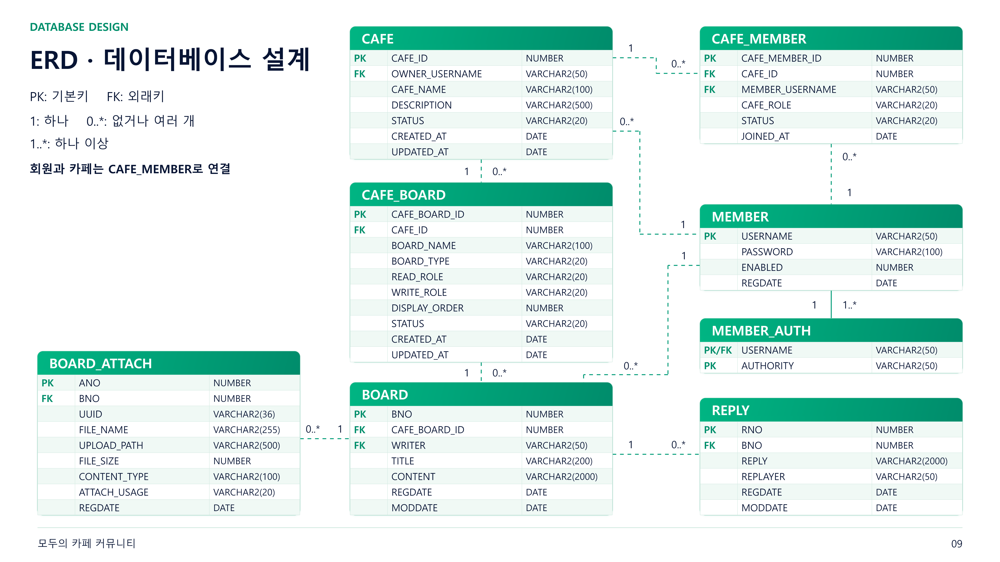

# deepstudy — 모두의 카페

관심사별 카페를 만들고 회원과 게시판 접근 권한을 관리할 수 있는
Spring MVC 기반 커뮤니티 서비스입니다.

게시글·댓글·첨부파일 기능과 함께 EC2 배포 및 S3 외부 백업을 구성했습니다.

- 서비스 주소: https://moducafe.duckdns.org/
- 학습 및 개인 프로젝트로 운영하며, EC2 실행 상태에 따라 접속이 제한될 수 있습니다.

[운영 가이드](docs/operations.md) · [복구 가이드](docs/recovery.md) · [테스트 가이드](docs/testing.md)

## 1. 프로젝트 목표

- 카페 가입 상태와 역할, 게시판의 권한 설정에 따라
  게시글과 첨부파일의 접근을 제어합니다.
- 게시글과 첨부파일을 함께 처리할 때 DB 작업의 성공·실패에 맞춰
  파일을 정리하여 데이터와 파일 사이의 불일치를 줄입니다.
- 코드 변경을 서버에 배포하고, DB와 첨부파일을 외부에 백업하여
  서비스를 운영하고 복구하는 과정까지 경험합니다.

## 2. 주요 기능

### 회원 및 인증

- 회원가입, 로그인, 로그아웃
- Spring Security 기반 인증과 권한 검사
- BCrypt를 이용한 비밀번호 해시 처리
- 계정당 동시 로그인 세션을 1개로 제한
- 같은 계정으로 새로 로그인하면 기존 세션은 다음 요청에서 만료 처리
- 기존 접속자에게 로그인 종료 안내 표시
- Spring Security의 메모리 기반 세션 관리 사용: 현재 단일 앱 서버 기준

### 카페 및 회원 관리

- 카페 목록, 조회, 생성, 수정, 삭제
- 카페 가입 신청, 승인, 거절, 탈퇴
- 카페 회원 역할 변경과 강퇴·강퇴 해제
- 카페 내 게시판 생성, 수정, 삭제
- 게시판에 설정된 권한에 따른 접근 검사

### 게시글 및 댓글

- 게시글 목록, 조회, 등록, 수정, 삭제
- 페이지 단위 목록 조회
- 댓글 목록 조회·등록·수정·삭제 API
- TinyMCE를 이용한 게시글 본문 작성·수정
- 카카오맵 API를 이용한 장소 검색·선택 및 게시글 내 지도 표시
- 게시글 HTML 정제

### 첨부파일

- 본문 이미지 및 첨부파일 저장
- 날짜별 폴더와 UUID 기반 파일명 사용
- 첨부파일 조회 시 카페 접근 권한 검사
- 허용된 본문 이미지는 화면에 표시하고, 다른 파일은 다운로드로 제공
- DB 트랜잭션 롤백 시 새로 저장한 파일 정리
- DB 트랜잭션 커밋 후 삭제 대상 파일 정리

## 3. 기술 스택

| 구분 | 사용 기술 |
|---|---|
| 언어 | Java 8 |
| 웹 프레임워크 | Spring MVC 5.3.39 |
| 인증·인가 | Spring Security 5.8.14 |
| DB 접근 | MyBatis 3.5.19, Spring JDBC |
| 데이터베이스 | Oracle |
| 화면 | JSP, JSTL, Apache Tiles |
| 에디터 | TinyMCE |
| 지도 | Kakao Map API |
| 빌드 | Maven, WAR |
| 애플리케이션 서버 | Tomcat 9 |
| 웹 서버 | Nginx |
| 배포 | Docker Compose, AWS EC2 |
| CI/CD | GitHub Actions, Docker Hub |
| 외부 백업 | Amazon S3 |
| 테스트 도구 | JUnit 5, Mockito, Spring Test |

## 4. 애플리케이션 구조

```text
요청
 ↓
Controller
 ↓
Service — 권한 검사 및 비즈니스 로직, 트랜잭션 처리
 ↓
MyBatis Mapper
 ↓
Oracle
```

첨부파일의 실제 내용은 파일 저장소에서 관리하고,
이름·경로·크기 등의 메타데이터는 DB에서 관리합니다.

```text
spring-legacy-board/
├─ src/
│  ├─ main/
│  │  ├─ java/kr/or/oti/
│  │  │  ├─ controller/
│  │  │  ├─ service/
│  │  │  ├─ mapper/
│  │  │  ├─ domain/
│  │  │  ├─ dto/
│  │  │  └─ security/
│  │  ├─ resources/
│  │  │  ├─ mappers/
│  │  │  ├─ db.properties.example
│  │  │  └─ upload.properties.example
│  │  └─ webapp/WEB-INF/
│  │     ├─ spring/
│  │     ├─ views/
│  │     └─ tiles/
│  └─ test/
├─ sql/
│  ├─ create_tables.sql
│  └─ create_sequences.sql
├─ docs/
│  └─ images/
│     └─ erd.png
├─ deploy/
│  ├─ nginx/
│  ├─ tomcat/
│  └─ scripts/
│     ├─ backup-db.sh
│     ├─ backup-attachments.sh
│     └─ renew-cert.sh
├─ .github/workflows/main.yml
├─ compose.yaml
├─ Dockerfile
├─ pom.xml
└─ readme.md
```

## 5. ERD



발표 당시 작성한 ERD입니다. 현재 DB의 컬럼 정보를 확인하여
아래 표에 정정 사항과 길이 단위를 정리했습니다.

| 항목 | 이미지 표기 | 현재 DB |
|---|---|---|
| 댓글 작성자 컬럼 | REPLAYER | REPLYER |
| REPLY.REPLY | VARCHAR2(2000) | VARCHAR2(500 BYTE) |
| BOARD.WRITER | VARCHAR2(50) | VARCHAR2(100 BYTE) |
| BOARD_ATTACH.FILE_NAME | VARCHAR2(255) | VARCHAR2(255 CHAR) |
| BOARD_ATTACH.UPLOAD_PATH | VARCHAR2(500) | VARCHAR2(500 CHAR) |

주요 테이블:

- MEMBER / MEMBER_AUTH
- CAFE / CAFE_MEMBER / CAFE_BOARD
- BOARD / BOARD_ATTACH / REPLY

## 6. 로컬 실행

### 준비 사항

- JDK 8
- Maven
- Tomcat 9
- Oracle과 접속 가능한 DB 계정
- 프로젝트에서 사용하는 테이블 및 시퀀스
- 쓰기 가능한 첨부파일 저장 폴더

### DB 초기화

테이블과 시퀀스를 생성할 수 있는 Oracle DB 계정을 준비합니다.
아래 스크립트는 프로젝트 객체가 없는 빈 계정에서
최초 실행하는 용도입니다.

계정에는 로그인·테이블·시퀀스 생성 권한과
테이블을 저장할 테이블스페이스 할당량이 필요합니다.

문자열 길이 단위 설정이 적용되도록
각 파일을 맨 위부터 전체 스크립트로 실행합니다.

1. `sql/create_tables.sql`
2. `sql/create_sequences.sql`

DBeaver에서 해당 계정으로 연결한 뒤 각 SQL 파일을 열고,
위 순서대로 SQL 스크립트를 실행합니다.

실행 후 테이블 8개와 시퀀스 6개가 생성되었는지 확인합니다.

초기화 스크립트는 DB 구조만 생성하며, 회원·카페·게시글 데이터는 포함하지 않습니다.

이어서 `db.properties`에 해당 계정의 접속 정보를 설정합니다.

### 설정 파일 준비

Windows PowerShell 기준으로 예제 파일을 복사합니다.

```powershell
Copy-Item src/main/resources/db.properties.example src/main/resources/db.properties
Copy-Item src/main/resources/upload.properties.example src/main/resources/upload.properties
```

`db.properties`에 로컬 DB 정보를 설정합니다.

```properties
db.driver=oracle.jdbc.OracleDriver
db.url=jdbc:oracle:thin:@localhost:1521/YOUR_SERVICE_NAME
db.username=YOUR_USERNAME
db.password=YOUR_PASSWORD
```

서비스명은 사용하는 Oracle 환경에 맞게 변경합니다.
EC2 운영 환경에서는 `FREEPDB1`을 사용합니다.

`upload.properties`에 로컬 첨부파일 저장 경로를 설정합니다.

```properties
upload.root=C:/upload
```

환경별 설정 파일은 Git에서 제외합니다.

#### EC2 DB에 연결하는 경우

SSH 설정에 EC2 접속 별칭을 등록한 경우 다음과 같이 터널을 엽니다.

```powershell
ssh -N -L 127.0.0.1:1522:127.0.0.1:1521 -o ExitOnForwardFailure=yes ec2-ubuntu
```

`ec2-ubuntu`는 본인의 SSH 접속 별칭으로 변경합니다.
앱 실행 중에는 터널을 유지하고, DB URL을 다음으로 설정합니다.

```properties
db.url=jdbc:oracle:thin:@127.0.0.1:1522/FREEPDB1
```

운영 계정과 분리된 테스트 계정을 사용합니다.
앱을 로컬에서 실행하면 첨부파일은 로컬 업로드 경로에 저장됩니다.

### 외부 API 설정

게시글 에디터와 지도 기능에 TinyMCE와 Kakao Map API를 사용합니다.
로컬 실행 시 본인의 API 키와 실행 주소에 맞게 설정합니다.

#### TinyMCE

- Tiny Cloud에서 API 키를 발급받습니다.
- `register.jsp`, `modify.jsp` 상단의 TinyMCE 스크립트 URL에
  본인의 API 키를 설정합니다.
- localhost 이외의 주소에서 실행할 때는 Tiny Cloud에
  해당 도메인을 허용 도메인으로 등록합니다.

#### Kakao Map API

- Kakao Developers에서 앱을 생성하고 JavaScript 키를 발급받습니다.
- JavaScript SDK 도메인에 실제 실행 주소를 등록합니다.
  예: `http://localhost:8080`
- `register.jsp`, `modify.jsp`, `read.jsp`의 지도 SDK URL에서
  `appkey`를 본인의 JavaScript 키로 변경합니다.

위 JSP 파일은 `src/main/webapp/WEB-INF/views/board/`에 있습니다.

### 빌드 및 실행

배포 워크플로와 같은 방식으로 WAR를 생성합니다.

```bash
mvn clean package
```

이 명령은 테스트를 실행한 뒤 WAR를 생성합니다.

생성된 WAR를 Tomcat 9에 배포하거나 STS의 Tomcat 서버에서 실행합니다.
기본 경로 `/`에 접속하면 카페 목록 `/cafe`로 이동합니다.
로컬 URL은 Tomcat의 컨텍스트 경로에 따라 달라집니다.

운영용 `compose.yaml`은 EC2 경로와 인증서, 기존 Oracle 볼륨을 사용하므로
로컬 환경에서 그대로 실행하는 설정은 아닙니다.

## 7. 배포 구성

```text
브라우저
   │ HTTPS
   ▼
Nginx
   │
   ▼
Tomcat / Spring MVC
   ├─ Oracle
   └─ 첨부파일 저장 폴더
```

Docker Compose로 다음 컨테이너를 관리합니다.

| 컨테이너 | 역할 |
|---|---|
| nginx | HTTPS 및 리버스 프록시 |
| deepstudy | Tomcat과 애플리케이션 |
| oracle-db | Oracle 데이터베이스 |

- 앱 컨테이너는 host 네트워크 사용
- Oracle 포트는 호스트의 `127.0.0.1:1521`에 바인딩
- Oracle 데이터는 외부 Docker 볼륨 `oracle-data`에 보관
- 첨부파일은 EC2의 `/home/ubuntu/deepstudy-uploads`에 보관
- HTTPS 인증서 갱신은 예약 작업으로 실행

## 8. GitHub Actions 배포

`main` 브랜치에 push하면 다음 과정이 실행됩니다.

1. 소스 체크아웃과 Java 8 환경 준비
2. 배포용 DB·업로드 설정 생성
3. Maven으로 테스트 실행 및 WAR 빌드
4. Docker 이미지 빌드 및 Docker Hub 업로드
5. Compose, Nginx·Tomcat 설정, 운영 스크립트를 EC2로 복사
6. Nginx 설정 검사와 앱 이미지 갱신
7. `/cafe`의 HTTP 200 응답 확인

배포 시 앱과 Nginx를 갱신하고 Oracle 컨테이너는 유지합니다.

운영 스크립트는 Actions가 서버에 복사하며,
백업과 인증서 갱신의 정기 실행은 EC2의 cron이 담당합니다.

## 9. 백업 및 운영

예약 시간은 서버의 `Asia/Seoul` 시간대를 기준으로 합니다.

| 작업 | 실행 시간 | 실행 사용자 |
|---|---|---|
| 인증서 갱신 확인 | 매일 10:00, 16:00 | ubuntu |
| DB 백업 | 매일 16:00 | ubuntu |
| 첨부파일 백업 | 매일 16:10 | root |

EC2가 꺼져 있으면 예약 작업은 실행되지 않습니다.

### DB 백업

- Oracle Data Pump의 `expdp`로 SCOTT 스키마 백업
- `FLASHBACK_TIME=SYSTIMESTAMP`로 백업 기준 시점 지정
- 덤프와 로그를 EC2 호스트에 복사한 뒤 전용 S3 버킷에 업로드
- 호스트에 덤프와 성공 로그가 있는 백업을 대상으로 최근 7세트 유지
- 해당 정리 대상의 컨테이너 사본도 함께 삭제
- S3에는 자동 삭제 규칙을 설정하지 않음

### 첨부파일 백업

- 별도의 비공개 S3 버킷에 보관
- `aws s3 sync`로 새 파일과 변경된 파일 전송
- EC2에서 삭제된 파일도 이미 백업됐다면 S3에는 유지
- 예약 백업 방식이며 업로드 즉시 복사되는 구조는 아님

DB 덤프에는 첨부파일 메타데이터가 포함되지만,
이미지·문서의 실제 내용은 별도로 복구해야 합니다.

### 설정 및 인증 정보

- `app.env`, `oracle.env`, DB 접속 설정과 인증서는 Git에서 제외
- Actions 인증 정보는 GitHub Secrets로 관리
- EC2의 S3 접근은 IAM 역할로 처리
- DB 백업과 첨부파일 백업 버킷의 접근 권한을 각각 설정

## 10. 검증 내역

### 배포 및 외부 백업

- 배포 후 브라우저에서 서비스 동작 확인
- S3에 보관한 DB 덤프를 다운로드하여 원본과 일치 확인
- 첨부파일의 S3 업로드 및 파일 열람 확인

### DB 복원

- DB 덤프를 별도 테스트 계정으로 복원
- 원본과 복원된 테이블·시퀀스·인덱스 수 및 테이블별 행 수 일치 확인
- 복원된 스키마에 INVALID 객체가 없는지 확인

### DB 초기화 및 로컬 실행

- 빈 테스트 계정에서 DB 초기화 SQL 실행
- 테이블 8개·시퀀스 6개·인덱스 11개 생성 확인
- 초기화한 DB에 로컬 앱을 연결하여 회원가입·로그인·카페 생성·게시글 및 첨부파일 등록 확인

### 예약 작업

- DB 백업: 16:00 예약 실행 후 S3 저장 확인
- 첨부파일 백업: 16:10 예약 실행 및 완료 로그 확인
- 인증서 확인: 16:00 예약 실행, 갱신 대상 없음 및 Nginx 설정 검사·reload 확인

전체 테스트 50개가 통과했으며, 실패·오류·건너뛴 케이스는 없습니다.
실행 방법과 검증 범위는 [테스트 가이드](docs/testing.md)를 참고합니다.

GitHub Actions는 WAR 빌드 전에 테스트를 실행하며,
테스트가 실패하면 이미지 업로드와 배포를 진행하지 않습니다.

## 11. 향후 계획

- 상품·주문 모델과 트랜잭션 설계
- 테스트 결제 승인·조회·취소
- 멱등성을 이용한 중복 요청 처리
- 재고 동시성 제어와 락 비교
- 외부 결제 API 실패 및 상태 복구
- 부하 측정과 SQL·인덱스 개선
- 운영 로그와 모니터링 보완
- 첨부파일 실제 저장소의 S3 전환 검토

## 12. 관련 문서

- [운영 가이드](docs/operations.md): 배포, 환경 설정, 예약 작업, 로그 확인
- [복구 가이드](docs/recovery.md): 복구 준비와 절차 초안, 추가 검증 항목
- [테스트 가이드](docs/testing.md): 핵심 테스트 선정 기준, 실행 방법, 검증 범위와 한계
